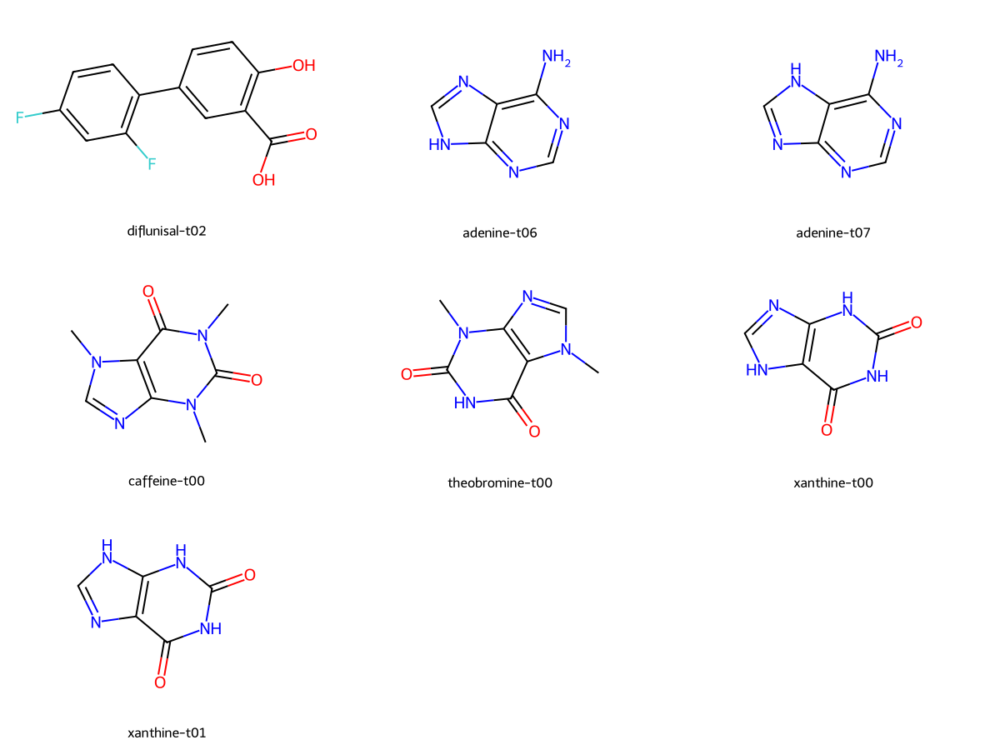

# 2주차 화학적 상태 검토

검토 근거는 PubChem에서 확인한 1주차 분자 식별, RDKit 상태 구조의 시각 확인, 실제 GFN2-xTB 최적화의 수소 위치·에너지다. 총 전하 0·단일항으로 계산했다. 아래 수치는 진공 전자 에너지이며, 용액·결정의 우세 상태나 pKa를 판정하지 않는다. xTB 단계에서는 Hessian을 계산하지 않았다.

| 분자 | 이합체 생성에 사용한 상태 | 단량체 xTB에서 관찰한 것 | 후속 DFT의 상태 범위 |
|---|---|---|---|
| 디플루니살 | t02: 방향족 카르복실산·페놀 | t02가 최저. t00/t01은 각각 약 +29.22/+30.56 kcal/mol. t03 시작점 3개는 수소 위치가 바뀌어 시작 상태 자체의 에너지로 해석하지 않는다. | 첫 비용 측정은 t02로 고정. 원래 이온쌍 시작 구조도 보존 |
| 아데닌 | 아미노형의 N–H 위치가 다른 t06/t07 | t06가 최저, t07은 +7.18 kcal/mol. 나머지 시작 형태는 최저치 기준 +9.88 kcal/mol 이상 | 중성 상태와 양성자 이동을 구분. xTB 최저 한 형태만으로 결정 상태를 고정하지 않음 |
| 카페인 | 중성 케토형 t00 | 이번 열거에서는 한 상태. 세 시드가 같은 형태를 유지 | 첫 단량체·이합체 비용 측정에 사용 |
| 테오브로민 | 케토형 t00 | t00가 최저. 두 에놀 시작 형태는 +10.96/+13.70 kcal/mol | 현재 이합체 풀은 t00에 한정. 다른 형태를 시험한 이합체 풀이라고 주장하지 않음 |
| 잔틴 | N–H 위치가 다른 케토형 t00/t01 | t00가 최저, t01은 +7.55 kcal/mol. 다른 시작 형태는 +9.19 kcal/mol 이상 | 두 케토형을 포함하되 전체 15개 상태의 이합체를 포괄하지는 않음 |

상태 ID는 [1주차 구조 목록](../reports/week1-molecule-identities.json)의 명시적 SMILES와 대응한다. 숫자 ID를 원자의 관용 번호로 해석하지 않는다. [상태별 실제 수치](../reports/week2-monomer-state-summary.json)에는 세 시드 중 최저값과 수소 위치 유지 여부가 있다.

**양성자 이동 후보를 DFT 전에 모두 없애면 안 된다.** 디플루니살의 카르복실산 H를 아데닌의 고리 N 쪽으로 옮긴 시작점 12개 중 11개가 xTB 최적화에 수렴했고, 11개 모두 원래 중성 상태 그래프와 같은 수소 소유 원자로 돌아왔다. 나머지 한 개는 구조 반복 한도에 도달했다. 이는 진공 GFN2-xTB의 결과다. 거리 기반 수소 소유 원자는 전자 전하의 검증이 아니며, 저자 원고의 결정 양성자 이동 해석과 직접 대조해 결론 낼 수 없다.

따라서 다음 주 디플루니살–아데닌의 최대 3개 DFT 시작점 안에서 원래 양성자 이동 XYZ를 별도로 검토한다. xTB 이완을 거친 구조만 선별하면 다른 방법에서 가능한 이온쌍 구조를 놓칠 수 있다. 원래 12개 XYZ와 원자 인덱스는 [후보 목록](../experiments/week2/chemistry-candidates.json)에 보존했다. 아직 이온쌍 DFT 계산을 실행하지 않았다.

초기 자세의 이름은 초기 생성 방식이다. 예를 들어 `stacked_contact`에서 시작한 구조라도 이완 뒤 수소결합 접촉이 생길 수 있다. 최종 자세는 거리·각도·무거운 원자 RMSD와 상태를 다시 확인한다. 군집 수는 보수적 분류이며 실제 독립 최소점 수가 아니다. 종류별 최대 3개 임시 목록은 전체 상태·자세 공간의 완전한 탐색을 뜻하지 않는다.

첫 비용 측정은 원래 계획의 알려진 양성 사례인 디플루니살–카페인이다. 분자쌍 안의 자세 순위에는 형성 라벨을 사용하지 않았지만, 이 실험 전체를 블라인드 검증으로 해석하지 않는다. 현재 첫 DFT는 디플루니살 t02, 카페인 t00, 이합체 p36이고 모두 초기 수소 위치·무거운 원자 연결을 유지한 xTB 출력에서 시작한다.

첫 중성 단량체의 xTB 입력과 검증된 DFT 최소점을 비교한 무거운 원자 RMSD는 디플루니살 0.0229 Å, 카페인 0.0207 Å였다. 전체 분자의 강체 회전·병진을 정렬하고 같은 원자 인덱스를 대응시킨 값이다. 두 단량체에서는 초기 구조가 DFT 최소점에 가까웠지만, 결합 에너지의 정확도나 이온쌍 상태를 검증하는 지표는 아니다. 수치와 정렬 정의는 [DFT 검증 기록](../reports/week2-drug-verification.json)에 있다.
