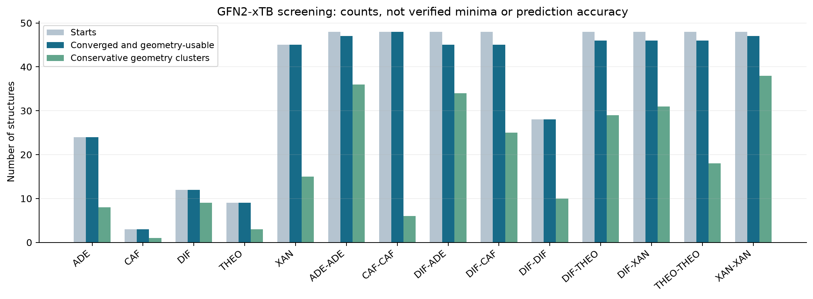
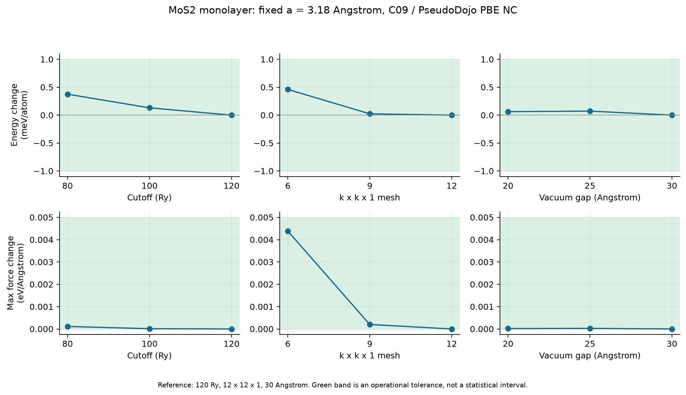
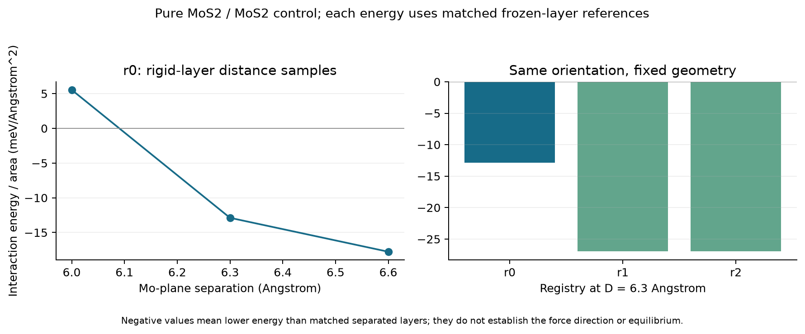

# 2주차 실제 실험 결과

작성 시각 2026-09-11T03:50:29.271695+00:00. **2주차 핵심 계산과 검증을 완료했다**. 초기 구조 생성, xTB 선별, 첫 약물 DFT 비용 측정, MoS₂ 정밀도 검사와 순수 이중층 대조를 실행했다. 전체 공결정 판정과 이종 이중층 본 실험은 다음 단계다.

## 약물: 후보 선별과 첫 최소점

31개 호변이성질체 후보 × 시드 3개로 단량체 93개, 9종 분자쌍으로 이합체 412개를 생성했다. 모든 초기 구조의 원자 수·순서·거리 기반 결합 연결을 검사했다. 이합체는 수소결합·방향족 접촉을 포함하며, 디플루니살–아데닌에는 양성자를 옮긴 초기 후보 12개를 포함했다. 모두 총 전하 0·단일항이다. 시작 형태는 상태 공간의 완전한 열거가 아니다.

| 종류 | xTB 시작 | 엔진 수렴 | 구조 사용 가능 | 보수적 구조 군집 |
|---|---:|---:|---:|---:|
| adenine | 24 | 24 | 24 | 8 |
| caffeine | 3 | 3 | 3 | 1 |
| diflunisal | 12 | 12 | 12 | 9 |
| theobromine | 9 | 9 | 9 | 3 |
| xanthine | 45 | 45 | 45 | 15 |
| adenine--adenine | 48 | 47 | 47 | 36 |
| caffeine--caffeine | 48 | 48 | 48 | 6 |
| diflunisal--adenine | 48 | 45 | 45 | 34 |
| diflunisal--caffeine | 48 | 45 | 45 | 25 |
| diflunisal--diflunisal | 28 | 28 | 28 | 10 |
| diflunisal--theobromine | 48 | 46 | 46 | 29 |
| diflunisal--xanthine | 48 | 46 | 46 | 31 |
| theobromine--theobromine | 48 | 46 | 46 | 18 |
| xanthine--xanthine | 48 | 47 | 47 | 38 |

엔진 수렴과 구조 사용 가능은 별도 판정이다. 무거운 원자 연결 변화·미배정 수소·분리는 제외 사유로 보존했고, 양성자 소유 원자 변화는 삭제하지 않고 따로 기록했다. 수소 위치는 원래 상태 그래프 대비 변화와 실제 입력 좌표 대비 순변화를 구분했다. 의도적으로 양성자를 옮긴 12개 시작점에서는 두 기준이 다르다. 거리로 추정한 수소 위치는 전자 전하나 결합차수의 검증이 아니다. 군집은 시작 상태·양성자 변화·기하학적 접촉을 나누고 무거운 원자 RMSD 0.75 Å로 묶었다. 원자 인덱스 접촉 서명은 대칭적으로 같은 접촉을 나눌 수 있어 군집 수를 실제 서로 다른 최소점 수로 해석하지 않는다. GFN2-xTB 선별에는 진동 계산이 없다. 양성자 이동 시작점 12개 중 수렴한 11개는 모두 원래 중성 상태 그래프와 같은 수소 소유 원자로 돌아왔다. 이는 진공 xTB의 기하 결과이며 결정의 양성자 상태를 판정하지 않는다. 다음 DFT 상태 검토에는 원래의 양성자 이동 XYZ도 남겨, xTB 이완만으로 이온쌍 가능성이 사라지지 않도록 한다.



첫 DFT는 상태가 유지된 디플루니살·카페인 단량체와 사용 가능한 최저 xTB 에너지의 이합체를 골랐다. **r2SCAN-3c, TightSCF/TightOpt, 진공**이다. 최초 최적화는 직렬, 이합체의 재개 진동 계산은 검증된 MPI 환경을 사용했다. 각 분자쌍 안에서 자세를 생성하고 xTB 에너지로 정렬할 때 형성/미형성 라벨을 사용하지 않았다. 첫 비용 측정 분자쌍은 원 계획에 따라 알려진 양성 사례를 선택했으므로, 독립 블라인드 검증은 아니다.

| DFT 대상 | 실제 누적 계산 시간 | 병진·회전 제외 진동 | 판정 |
|---|---:|---|---|
| diflunisal | 20.65분 | 72개, 최저 42.27 cm⁻¹ | 최소점 확인 |
| caffeine | 18.09분 | 66개, 최저 56.18 cm⁻¹ | 최소점 확인 |
| diflunisal--caffeine | 173.10분 | 144개, 최저 25.80 cm⁻¹ | 최소점 확인 |

이합체는 87회 최적화 완료 후 사용자 요청으로 진동 계산 중 정지했다. 보존한 동일 좌표에서 12프로세스로 Freq만 새로 실행했다. 위 이합체 시간에는 최초 시도 156.34분과 재개한 진동 계산 16.75분이 모두 포함된다. 따라서 동일 코어 수로 연속 실행한 Opt+Freq 비용으로 해석하지 않는다.

첫 이합체의 전자 결합 에너지 `B = E(AB) − E(A) − E(B)`는 **-5.420 kcal/mol**이다. 한 이합체 자세와 각 단량체의 최적화 에너지를 사용한 값이다. 전역 최소점·결정 형성 자유에너지·용해도·약효가 아니다. 자기 결합 `AA`, `BB` DFT 대조군을 아직 계산하지 않았으므로 경쟁 점수 `X = E(AB) − ½E(AA) − ½E(BB)`는 보고하지 않는다. ZPE·열·용매 보정도 이 수치에 포함하지 않는다.

## 반도체: 같은 구조에서 수치 정밀도 확인

1주차 내부 이완 좌표와 a=3.18 Å를 고정했다. vdW-DF-C09 + PseudoDojo nc-sr-04 PBE scalar NC, 전하밀도 cutoff=4×파동함수 cutoff, 전자 수렴 1e-10 Ry다. 원 논문과 정확한 의사퍼텐셜 파일 버전은 아직 맞추지 못했다.

첫 7개 SCF에서 cutoff 80/100/120 Ry, k 6/9/12, 실제 진공 간격 20/25/30 Å를 한 축씩 바꿨다. 120 Ry·k12·30 Å는 비교 기준이며 절대 정확한 값으로 가정하지 않는다. 단층 목표는 에너지 1 meV/atom, 최대 원자 힘 변화 0.005 eV/Å다.

선택한 조합은 **80 Ry / k=6×6×1 / 진공 20 Å**이다. 세 축을 동시에 합친 재계산의 기준 대비 에너지 차이는 **0.897291 meV/atom**, 최대 힘 변화는 **0.00463386 eV/Å**였고, 조합 판정은 `passed`다. 이 정밀도는 해당 고정 구조의 MoS₂에 한정한다. 허용오차를 만족하는 가장 작은 시험 설정을 후보로 골랐다. 실제 실행 시간은 SCF 반복 횟수의 영향도 받아 cutoff와 단조롭게 비례하지 않는다.



같은 방향의 R-type MoS₂/MoS₂ 이중층을 만들고 원시 셀 벡터로 r0=(0,0), r1=(1/3,2/3), r2=(2/3,1/3)을 비교했다. 각 이중층에서 동일 셀·동일 좌표·동일 계산 설정인 두 분리층을 빼고 면적으로 나눴다. 재사용은 동일한 입력을 다시 참조하는 경우만 허용했다.

| 설정 / 이동 | Mo 평면 거리 Å | 층간 에너지 meV/Ų |
|---|---:|---:|
| selected / r0 | 6.00 | 5.546022 |
| selected / r0 | 6.30 | -12.881260 |
| selected / r0 | 6.60 | -17.765813 |
| selected / r1 | 6.30 | -26.949472 |
| selected / r2 | 6.30 | -26.949472 |
| strict / r0 | 6.30 | -12.790956 |

대표 r0·D=6.3 Å의 두 설정 차이는 **0.090304 meV/Ų**이다. 대칭상 동등한 r1/r2 차이는 **2.34758e-07 meV/Ų**다. 각각의 운영 기준은 0.1 meV/Ų다. 이 검사는 모든 거리·이동·Se 포함 조성에서 같은 오차 상한을 보장하지 않는다.

r0에서 가장 낮게 나온 표본 거리는 **6.6 Å**이며, 양쪽에 더 높은 에너지 표본이 있는지는 `False`다. 그 표본에서 상층 전체의 z방향 힘은 **+0.039353 eV/Å**이다. 여기서 양의 힘은 층간 거리를 늘리는 방향이다. 음의 층간 에너지와 힘이 0인 평형은 별개이며, 이번 고정 층 거리 표본으로 평형 거리·면내 격자·포논 안정성을 확정하지 않는다.



## 계산 비용과 다음 단계

이번 엔진 점유 시간 합계는 **5.427시간**: xTB 14.42분, 핵심 ORCA 211.84분, QE 89.18분, 별도 병렬 검증 10.19분이다. 준비·다운로드·분석 시간은 제외하며 중단된 실제 계산 시간은 포함한다. 1주차를 합쳐 약물 **4.116/80시간**, 반도체 **1.553/40시간**을 사용했다. 동시 엔진 1개, QE OpenMP 4/BLAS 1이며 ORCA의 직렬/병렬 비용은 위에서 구분했다. RSS는 프로세스 트리 샘플 값이며 전체 Mac 사용량·순간 최대치와 다르다.

종류별 1개로 남은 필수 대조군을 채우는 시나리오는 약 24.1시간, 종류별 최대 3개까지 채우는 시나리오는 약 79.5시간이다. 후자가 2배 느려지면 159.0시간이다. 남은 약물 예산은 75.9시간이며, 최대 3개 시나리오는 남은 예산을 초과한다. 첫 새 병렬 Opt+Freq의 실제 비용을 확인하기 전 전체 확장을 확정하지 않는다. 이는 단량체 두 개 중 느린 시간과 중단·병렬 재개를 포함한 이합체 누적 시간을 대입한 과거 비용 기반의 참고 시나리오다. 앞으로의 병렬 Opt+Freq 전체 실행 시간을 예측한 값이 아니며, 병렬 EnGrad의 가속률도 전체 Opt/Freq에 곱하지 않았다. 분자·배좌별 반복 횟수, 함수/용매 단일점, 재시도 비용은 별도다. 다음 약물 묶음은 남은 단량체 3종·이합체 8종과 아데닌의 직접 양성자 이동 시작점 1개, 총 12개 최적화 시작점으로 계획했다. 새 진동 계산은 최대 12개이며, 최적화 후 같은 상태·같은 종류의 동일 최소점이면 중복 Hessian을 줄인다. 구별되는 최소점마다 진동 검증은 유지한다. 그 뒤 상태·접촉 다양성과 비용을 보고 종류별 최대 3개까지 확장한다. 현재 군집별 최대 3개 목록은 상태 검토가 필요한 임시 목록이다.

## 병렬 실행 재검토

물의 2프로세스 Opt/Freq가 정상 완료됐고, 기존 직렬 결과와 에너지 1e-6 Hartree·진동수 0.1 cm⁻¹ 이내로 일치했다. 이어 동일한 50원자 이합체 좌표에서 EnGrad를 설정마다 두 번 실행해 에너지와 힘 차이 기준을 확인했다.

| MPI 프로세스 | 중앙 실행 시간(초) | 1프로세스 대비 속도 |
|---|---:|---:|
| 1 | 171.177 | 1.00배 |
| 8 | 40.624 | 4.21배 |
| 12 | 37.756 | 4.53배 |
| 16 | 37.574 | 4.56배 |

직렬 기준 최대 에너지 차이는 1.97e-09 Hartree, 최대 원자별 기울기 차이는 3.69e-10 Hartree/Bohr로 사전 기준 1e-6 및 1e-5 이내였다.

시험한 병렬 설정 중 가장 빠르게 관측된 것은 **16프로세스**다. 12프로세스가 가장 빠른 설정의 105% 이내에 들어가므로 재개에는 **12프로세스**를 선택했다. 두 반복의 결과이며 열·OS 변동과 다른 분자의 스케일링은 남는다. 전체 최적화 반복 수나 이합체 Hessian의 가속률을 측정한 것은 아니다. 기존 1코어 연구 결과와 실제 병렬 검증 비용을 분리해 보존했다.

[코어 수 비교 계획과 설치·검증 범위](../docs/WEEK2_PARALLEL_REVIEW.ko.md)

MoSe₂와 이종 이중층에는 단층·층간 정밀도를 다시 확인해야 한다. 공통 면내 격자와 기준 층간 거리를 확정한 뒤 9점 기준 행렬로 진행한다. 24원자 계면 교환 27점 행렬은 그 이후의 조건부 단계다. **3주차 계산은 시작하지 않았다.**

최종 저널 보충자료와 미형성 시도별 조건은 미확정이다. 이를 확보하기 전 실험 실패 원인을 계산 에너지로 설명하지 않는다. 이번 계산은 D1/S1 가설의 지지·반박이나 학술적 신규성을 판정하는 데이터까지 도달하지 않았다.

## 증거와 재검증

핵심 DFT 검토 필요 작업: []. 사용자 요청으로 중단한 최초 시도: ['w2-diflunisal--caffeine-opt-freq']. xTB 검토 필요 후보: 14개. 병렬 초기 검증 실패: ['p2-water-n2-r0']. 첫 물 MPI 시도는 라이브러리 검색 오류로 종료됐고, 작업 폴더에 필요한 라이브러리를 동봉한 별도 입력으로 수정 후 재검증했다. 모든 실패와 출력은 보존했고 자동 반복은 없었다. xTB는 91개 시점에서 3회 연속 미수렴으로 중단됐고, 누적 6개의 정상 SCC/구조 반복 한도 실패를 검토한 뒤 미실행 후보만 이어갔다. 이후 같은 실패 유형은 계속 제외하고 예상 밖 엔진/SCC 실패에 대한 중단 규칙을 유지했다. 최초 코드·중단 요약·검토 기록·후속 코드가 각각 보존돼 있다. ORCA 로그·Hessian·XYZ 에너지와 원자 순서를 교차 확인했다. QE는 XML의 전체 정밀도 좌표·셀·원자단위 에너지/힘으로 대조했다. 기존 파서/기하 검사 13개와 실제 Hessian을 활용한 재개 검증 회귀 검사 4개는 엔진 실행 횟수에 포함하지 않는다.

1주차 해시 115개 중 실제 계산 증거는 유지했다. 갱신한 README와 현재 프로토콜은 이전 바이트를 스냅샷으로 보존했다. 아래 명령은 계산 엔진을 시작하지 않고 저장된 결과를 다시 검사한다.

```bash
source scripts/activate.sh
python scripts/analyze_week2_monolayer.py
python scripts/check_week2_combined.py
python scripts/analyze_week2_xtb.py
python scripts/verify_week2_xtb.py
python scripts/verify_week2_drug.py
python scripts/verify_week2_bilayer_inputs.py
python scripts/analyze_week2_bilayers.py
python scripts/verify_week2_integrity.py
```

- [실행 계획과 사전 판정 기준](../docs/WEEK2_EXECUTION.ko.md)
- [수치·시간 요약](week2-summary.json)
- [후속 12개 시작점 계획, 미실행](../experiments/week2/next-panel-plan.json)
- [약물 독립 형식 검증](week2-drug-verification.json)
- [화학적 상태 검토와 이온쌍 후속 범위](../docs/WEEK2_STATE_REVIEW.ko.md)
- [xTB 전체 상태·군집 기록](week2-xtb-analysis.json)
- [첫 DFT 선택 근거](week2-first-dft-selection.json)
- [단층 수렴](week2-monolayer-convergence.json) · [조합 확인](week2-monolayer-combined.json)
- [이중층 좌표·기준층 대조](week2-bilayer-analysis.json)
- [1주차 보존 확인](week2-week1-preservation.json)
- [SHA-256 증거 목록](week2-evidence-sha256.json)

방법 근거: [ORCA 3c](https://www.faccts.de/docs/orca/6.1/manual/contents/modelchemistries/3cmethods.html), [xTB 최적화](https://xtb-docs.readthedocs.io/en/latest/optimization.html), [층내/층간 분리 원 논문](https://arxiv.org/html/2503.15432v1). 수치 허용오차와 후보 개수는 이번 파일럿의 운영상 선택이다.
