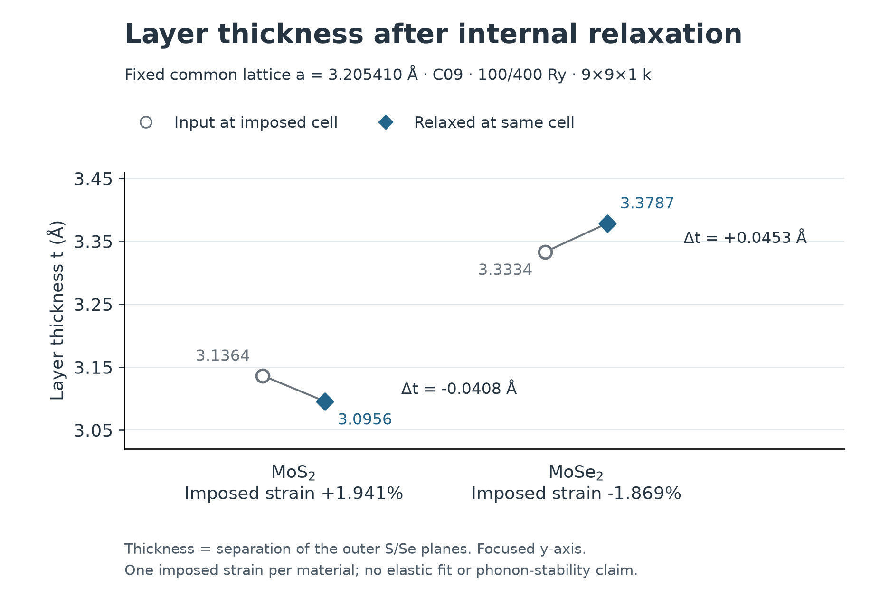

# 공통 격자에서 단층 내부 좌표 이완

2026-09-29 14:53 UTC 기준. MoS₂와 MoSe₂ 모두 종료·원시 검증을 통과했다. 두 층의 면내 길이를 사전에 정한 공통값 3.205410063 Å로 맞춘 뒤, 셀을 고정하고 원자 위치만 이완한 결과다. 두 층 사이 결합 에너지는 아직 검증하지 않았다.

| 항목 | MoS₂ 실측값 | MoSe₂ 실측값 |
|---|---:|---|
| 공통 격자에 의한 면내 변형률 | +1.941217% | −1.868668% |
| 이완 전 층 두께 (Å) | 3.136445905 | 3.333411179 |
| 이완 후 층 두께 (Å) | 3.095624370 | 3.378721101 |
| 최대 원자 이동 (Å) | 0.020410767 | 0.022654961 |
| 최종 최대 원자 힘 (eV/Å) | 0.0000186512 | 0.0000377423 |
| 최종 SCF 잔차 (Ry) | 4.98650e−13 | 2.55103e−13 |
| 벽시계 실행 시간 (초) | 713.436 | 925.631 |

층 두께는 위아래 칼코젠 원자의 z 좌표 차이다. MoS₂는 면내로 늘어난 조건에서 내부 좌표를 이완하자 두께가 약 0.04082 Å 줄었다. 잔여 원자 힘은 기준 0.005 eV/Å를 충족한다. 최종 총에너지는 −2514.716220642 eV이고, 전자 수는 26이다. 이 값은 정해진 계산 조건의 총에너지이며 이종층 결합 에너지나 실험 안정성을 뜻하지 않는다.

MoSe₂는 면내로 줄인 조건에서 두께가 약 0.04531 Å 늘었다. 최종 최대 원자 힘도 같은 기준을 충족하며, 총에너지는 −8499.173633162 eV, 전자 수는 46이다. 두 공통 격자 이완의 실행 시간 합계는 1,639.067초(27.3178분)다. 서로 다른 조성의 절대 총에너지를 비교해 안정성 순위를 매기지 않는다.

공통 설정은 C09, NC 의사퍼텐셜, cutoff 100/400 Ry, 9×9×1 k 격자, 초기 진공 간격 25 Å다. 셀 높이는 고정했으므로 원자 위치가 움직인 뒤 실제 빈 간격은 MoS₂ 25.040821534 Å, MoSe₂ 24.954690077 Å가 됐다. 후속 이중층 조립에서는 새로 정한 전체 이중층 진공 간격과 정확히 같은 셀의 분리층을 사용한다.

최종 면내 응력 성분은 QE 출력 부호 기준 MoS₂ 약 −11.2175 kbar, MoSe₂ 약 +10.4565 kbar다. 이번에는 면내 길이를 의도적으로 늘이거나 줄여 고정했으므로 응력이 0일 필요가 없다. 격자 자체를 이완한 앞선 평형 계산과 종료 조건이 다르다. 또한 이 3차원 응력 수치는 진공을 포함한 셀 높이에 의존하므로 그대로 벌크 재료의 응력이나 독립적인 2차원 탄성 상수로 해석하지 않는다. 포논 안정성도 아직 검증하지 않았다.

[MoS₂ 원시 감사](common-layer-audits-r1/mos2.json)는 기존 공통 설정 선택의 증거와 이번 계산을 포함한 139개 출처 해시를 고정했다. 입력이 실제 평형 구조에서 공통 격자로 변환한 좌표인지, 최종 셀이 고정돼 있는지, 전자/기하 수렴·힘·함수·의사퍼텐셜·k 격자·cutoff·실행 파일·실제 4 OpenMP/1 BLAS 설정을 검사했다. 마지막 로그 힘과 XML 힘의 단위 변환 차이는 성분 최댓값 1.17884e−7 eV/Å로 출력 반올림 범위였다.

[MoSe₂ 원시 감사](common-layer-audits-r1/mose2.json)도 같은 검증과 139개 출처 해시 확인을 통과했다. 마지막 로그/XML 힘 차이는 5.29382e−8 eV/Å로 출력 반올림 범위였다. 두 감사의 요약이 제어기의 `common_lattice_layers`와 정확히 일치함도 확인했다.

읽기 전용 재검증 명령은 다음과 같다. MoSe₂ 종료 이전에는 감사 생성을 거절했고, 실제 종료 후에는 검증이 통과했다.

```sh
.venv/bin/python scripts/verify_completion_common_layer.py mos2 --write
.venv/bin/python scripts/verify_completion_common_layer.py mose2 --write
```

두 층의 이완이 모두 끝나 제어기가 이종 이중층의 층간 거리 탐색으로 넘어갔다. 첫 입력은 r0 상대 위치, Mo 평면 간 거리 6.0 Å, 전체 이중층의 진공 간격 25 Å다. [첫 이중층 입력 감사](heterobilayer-first-input-audit-r1.json)에서 실제 두 공통 층으로부터 조립한 좌표·셀·거리·원자 순서가 입력과 일치함을 확인했다. 이는 입력 검증이며 아직 이중층 에너지·힘이나 최소 거리를 검증한 결과가 아니다. 이후 상대 위치 3개×거리 3개의 9점, 쌍과 분리층의 동일 조건 비교, 더 엄격한 수치 설정 검증이 남아 있다. 이 문서는 S02 전체 완료 판정이 아니다.

## 실제 두께 변화 그림



빈 원은 공통 셀로 변환한 초기 구조, 채운 마름모는 같은 셀에서 이완한 최종 구조다. 세로축은 두께 변화가 읽히도록 범위를 좁혔고, 두 물질에 같은 축을 사용했다. 선은 각 입력과 최종값을 연결하며 여러 변형률의 연속 측정이나 탄성 피팅을 뜻하지 않는다. 이 비교만으로 일반적인 변형 법칙이나 탄성 상수를 추정하지 않는다.

[SVG 원본](../figures/completion/common-layers-r1/layer-thickness.svg), [그림의 정확한 데이터·출처](../figures/completion/common-layers-r1/layer-thickness.json), [출처·출력 해시 검사](common-layer-figure-r1.json), [시각 검토](common-layer-figure-r1-visual-review.json)를 함께 보존했다. 원본 PNG와 780픽셀 폭, 흑백 936픽셀 폭에서 네 값·단위·범례·주석의 가독성을 확인했다. SVG는 구조와 수치 라벨을 검사했으며 별도로 렌더링한 시각 검사까지 했다고 주장하지 않는다.

```sh
MPLCONFIGDIR=/tmp/dft-mpl-cache .venv/bin/python scripts/plot_completion_common_layers.py
```
