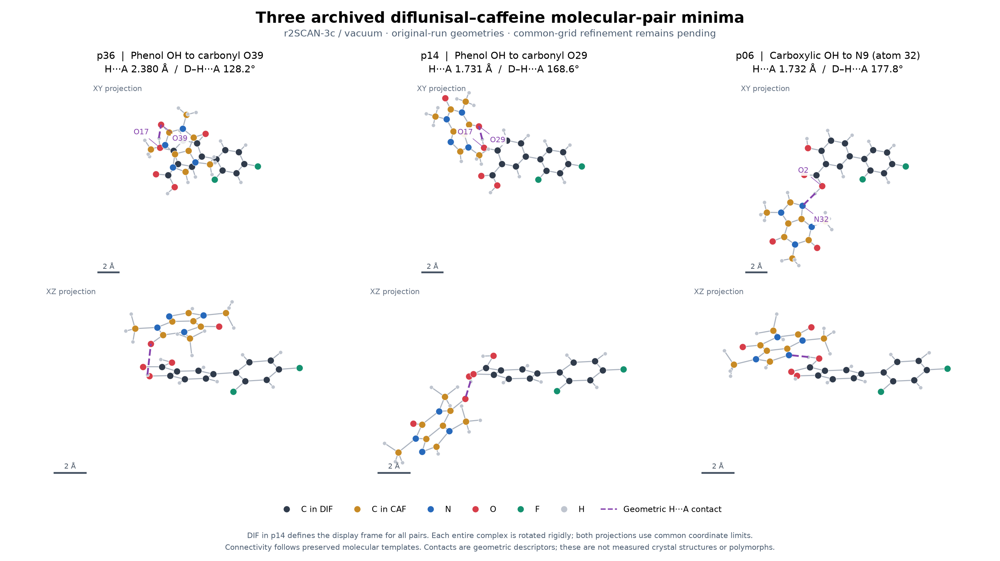

# 기존 약물 구조의 양성자 위치와 자세 재검토

2026-09-29. [원시 검토 JSON](drug-archived-geometry-r1.json)은 원래 17개 출발점의 이력을 다시 읽고 251개 출처 파일을 검증한 결과다. 기존 설정에서 최소점이 확인된 이력은 9개이며, 나머지 8개 출발점의 DFT는 아직 완료되지 않았다. 새 DFT를 실행하거나 원본 실패·중단 결과를 바꾸지 않았다.

## 카페인 복합체의 세 자세

세 출발점 p36, p14, p06의 기존 최소점은 전체 복합체를 함께 회전·병진 정렬하고 화학적으로 허용되는 원자 대응을 적용해도 구별된다. 무거운 원자 RMSD는 3.069–3.740 Å였으며, 모든 원자를 포함하는 RMSD의 계산된 하한도 2.456–2.992 Å로 기존의 엄격한 중복 기준 0.05 Å보다 크다. 두 분자를 각각 따로 정렬하지 않았다.

최종 좌표의 N/O–H···N/O 접촉을 기존 기하 기준(H···A <2.6 Å, D–H···A >120°)으로 읽으면 다음과 같다. 이 값은 기하 접촉이며 결합 에너지나 결합 차수의 측정은 아니다.

| 출발점 | 최종 접촉 | H···A 거리 Å | D–H···A 각도 | 0부터 시작하는 원자 번호 D/H/A |
|---|---|---:|---:|---|
| p36 | DIF 페놀 OH → CAF의 다른 카르보닐 O | 2.3802 | 128.16° | 17/25/39 |
| p14 | DIF 페놀 OH → CAF 카르보닐 O | 1.7309 | 168.63° | 17/25/29 |
| p06 | DIF 카르복실산 OH → CAF N9 | 1.7322 | 177.85° | 2/18/32 |

p36의 초기 이름은 `stacked_contact`지만 최종 구조에는 위의 길고 굽은 접촉도 있다. 초기 자세 이름만으로 최종 접촉을 분류하지 않는다. p06의 접촉은 기존 프로토콜에서 문헌이 제안한 COOH–N9 모티프에 대응하도록 고른 것이다. **세 고립 분자쌍 자세가 구별된다는 결과이며 공결정 다형 3개를 발견했다는 뜻은 아니다.**



그림은 p14 안의 DIF를 공통 기준으로 삼아 각 복합체 전체를 한 번에 회전·병진시킨 두 방향 투영이다. DIF 탄소는 짙은 회색, CAF 탄소는 황토색이며 보라색 점선은 표의 H···A 접촉이다. 분자의 모양을 변형하거나 거울 반사하지 않았다. 정렬 후 DIF 무거운 원자의 잔차는 p36 0.200 Å, p14 약 0 Å, p06 0.103 Å다. 이 값은 그림의 DIF 정렬에만 해당하며, 위의 **전체 복합체 간 RMSD**와 다르다. 모든 내부 원자 간 거리는 수치 반올림 오차 범위에서 보존되었고 접촉 각도도 다시 확인했다.

[SVG 원본](../figures/completion/drug-poses-r2/archived-dif-caf-poses.svg), [좌표·변환·출처 해시](../figures/completion/drug-poses-r2/figure-data.json), [그림 검증 기록](drug-geometry-figure-r2.json). 이전 r1 그림과 기록도 보존한다. 그림의 원자 번호는 0부터 시작하며 화학적 위치 이름 N9는 CAF의 원자 인덱스 32에 해당한다. 접촉의 짧음만으로 세 자세의 에너지 순위를 정하지 않는다.

```sh
.venv/bin/python scripts/plot_completion_drug_geometry_r2.py
```

## 양성자와 자기 결합 대조

기존 최소점 9개에서는 각 실제 DFT 입력과 최종 좌표를 비교했을 때 수소의 가장 가까운 무거운 원자가 바뀌지 않았다. 원래 상태 그래프와의 소유 원자 차이도 없었다. 이는 좌표에 따른 수소 소속 판정이며 전자적 부분 전하나 결정의 양성자 상태를 확정하지 않는다.

중요한 직접 양성자 이동 출발점인 DIF–ADE p36은 아직 DFT 미실행이다. 그 초기 구조에서는 H18이 DIF O2 대신 ADE N28 가까이에 놓여 있다(N–H 1.04 Å). 따라서 기존 9개 결과를 근거로 ADE 이온쌍이 DFT에서 유지되지 않는다고 결론 내릴 수 없다. 입력과 최종 좌표의 순변화, 원래 중성 그래프 대비 변화는 별도로 기록한다.

기존 DIF–DIF p05의 보정 후 최소점에는 두 카르복실산 간 O–H···O 접촉이 기록됐다. H···O 거리는 1.6717/1.5840 Å, 각도는 178.15/176.26°다. 이 구조의 이전 허수진동과 수치 정밀도 실패는 그대로 보존하며, 이번 기하 검토가 공통 정밀도 통과를 대신하지 않는다.

## 중복 판정 구현과 적용 범위

`scripts/completion_drug_geometry.py`는 무거운 원자의 원소·분자 종류·결합 차수·기하 수소 수를 보존하는 그래프 대응을 열거한다. 동일한 동종 이합체의 두 분자 교환도 허용하며, 거울 반사는 허용하지 않는다. 수소 대응은 각 소유 원자 안에서 배정하고 전체 구조를 다시 정렬한다. 이 수소 탐색 결과는 찾은 정렬의 상한이며 전역 최적 정렬을 증명한 값으로 표시하지 않는다. 무거운 원자의 완전한 대응 탐색에서 얻은 하한으로 충분히 멀리 떨어진 쌍은 구별할 수 있다. 대응 수 제한에 걸리거나 수소의 가까운 두 원자가 0.1 Å 이내로 경합하면 미확정으로 남긴다.

중복 후보의 기하·접촉 일치뿐 아니라, 동일한 비교 조건에서 에너지 차이 ≤0.01 kcal/mol도 요구한다. 함수·환경·수치 조건과 최소점의 원시 검증은 이 함수를 호출하는 전체 패널 단계의 책임이다. 이번 과거 자료 검토에서는 에너지를 혼합하지 않았고 공통 조건의 중복 최소점을 인증하지 않았다. 원래 17개 출발점의 선택이나 B/X 분모도 바꾸지 않았다.

회전·병진·수소 순서 교환, 동종 분자 교환, 서로 다른 에너지 조건의 거부, 양성자 이동 구별, 실제 CAF 자세 구별, 반사 금지 및 입력 파싱의 **7개 점검**이 통과했다. [검사 로그](drug-geometry-tests-r1.log). 전체 17개 공통 최소점과 용매 결과가 확보되면 같은 검토를 다시 적용한다.

```sh
.venv/bin/python -m unittest discover -s tests -p 'test_completion_drug_geometry.py' -v
```
