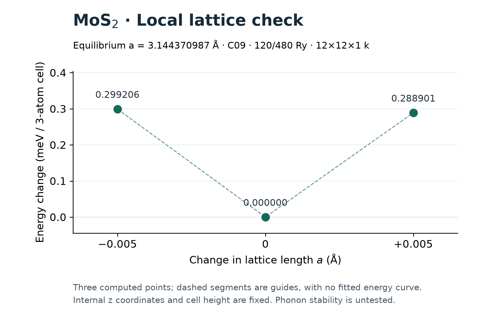
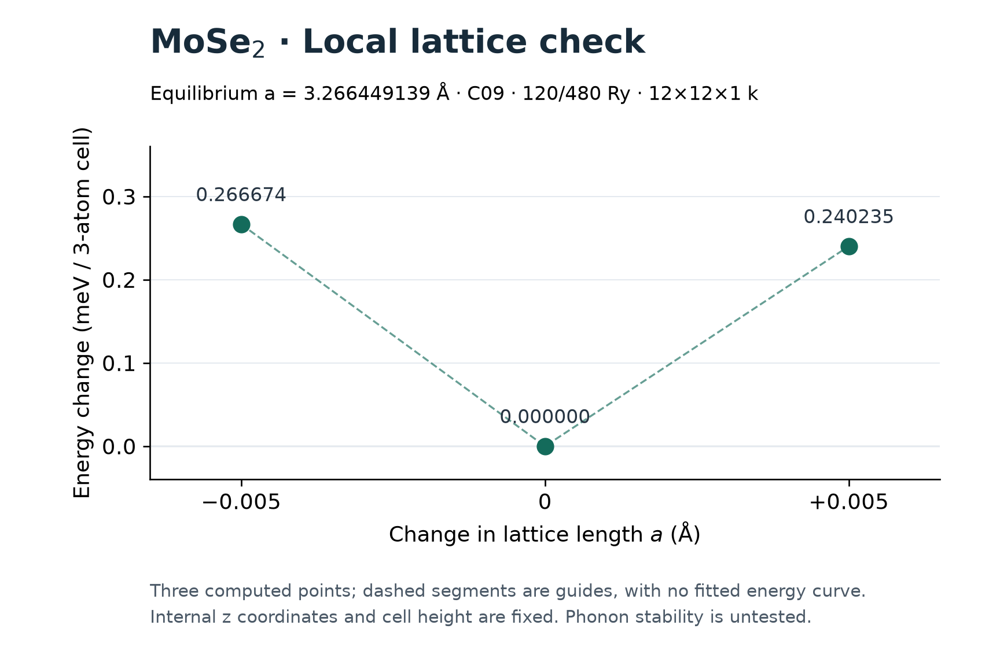

# MoS₂·MoSe₂ 단층 평형 격자 검증

2026-09-29. 두 면내 격자 최적화가 정상 종료했고, 종료된 원시 출력과 XML을 재검증했다. 이는 고정된 계산 조건에서의 평형 격자 결과다. 두 조성의 격자 양쪽점과 수치 설정 비교를 모두 원시 자료에서 검증했다. 공통 설정은 100/400 Ry·9×9×1 k 격자·진공 25 Å로 선택됐다. 공통 격자에서 두 층의 내부 좌표 이완도 원시 검증을 통과했고 이종 이중층 거리 탐색이 시작됐다. 전체 반도체 기준 계산은 아직 완료되지 않았다.

## 실제 결과

| 항목 | MoS₂ | MoSe₂ |
|---|---:|---:|
| 면내 격자 길이 a (Å) | 3.144370987 | 3.266449139 |
| 최종 최대 원자 힘 (eV/Å) | 0.0000290076 | 0.0008107615 |
| 최종 최대 면내 응력 성분 (kbar) | 0.00161990 | 0.00870985 |
| 최종 SCF 잔차 (Ry) | 1.31308e−14 | 7.40580e−13 |
| 실제 진공 간격 (Å) | 29.976324045 | 30.028380367 |
| 원자가 전자 수 | 26 | 46 |
| 실행 시간 (분) | 92.8471 | 91.1288 |
| 표본 최대 프로세스 트리 RSS (GiB) | 1.5988 | 1.6987 |

두 계산은 Quantum ESPRESSO 7.6, vdW-DF-C09, PseudoDojo nc-sr-04 standard PBE scalar NC, 파동함수/밀도 cutoff 120/480 Ry, 12×12×1 k 격자를 사용했다. z 방향 셀 벡터를 고정한 `2Dxy` 격자 최적화이며, 실제 실행은 OpenMP 4개와 BLAS 1개다. 평면 내 육각 대칭과 고정 z 셀도 확인했다. 두 작업의 벽시계 시간 합계는 3.066265시간이다.

기하 최적화가 끝났다는 메시지 뒤에도 최종 셀에 맞춰 기저를 다시 구성한 전자 계산이 있었다. 위 힘·응력·잔차는 그 최종 계산의 값이다. 두 작업 모두 `JOB DONE.`, 종료 코드 0, 닫힌 XML, 전자/기하 수렴, 최종 힘 ≤0.005 eV/Å 및 면내 응력 성분 ≤0.5 kbar 조건을 통과했다. RSS는 0.5초 간격 표본의 프로세스 트리 합이며 공유 페이지 중복이나 순간 최대값 누락 가능성이 있다. 두 실행 모두 메모리 표본 접근 실패는 0건이었다.

## 공통 격자로 이어지는 해석

MoSe₂가 계산상 선호하는 면내 간격은 MoS₂보다 크다. 기존 프로토콜은 두 층을 같은 주기 셀에 넣기 위해 두 격자의 산술평균을 사용하도록 정했다.

\[
a_{\mathrm{common}}=\frac{a_{\mathrm{MoS_2}}+a_{\mathrm{MoSe_2}}}{2}
=3.205410063\ \mathrm{Å},\qquad
\varepsilon_i=\frac{a_{\mathrm{common}}}{a_i}-1.
\]

따라서 이후 공통 격자 모형에서는 MoS₂를 **1.94122% 늘리고**, MoSe₂를 **1.86867% 줄이는** 조건이 된다. 이 값은 검증된 두 단층 결과에서 정한 공통 격자와 변형률이다. 공통 수치 설정의 MoS₂ 내부 좌표 이완은 713.436초에 종료했고, 최대 힘 1.86512e−5 eV/Å로 원시 검증을 통과했다. MoSe₂ 내부 이완도 925.631초에 종료했고 최대 힘 3.77423e−5 eV/Å로 원시 검증을 통과했다. [공통 격자 내부 구조 결과](COMMON_LATTICE_LAYERS.ko.md)에 두께 변화와 검증 범위를 기록했다. 산술평균은 사전에 정한 비교 조건이고, 두 층이 실제로 함께 있을 때의 무응력 평형 격자를 계산한 결과가 아니다. 서로 다른 조성의 절대 총에너지만으로 층의 안정성 순위를 정하지 않는다.

## MoS₂ 수치 설정 비교

동일한 평형 내부 구조에서 세 설정을 모두 계산하고, 원시 좌표·셀·전자 수·함수·의사퍼텐셜·cutoff·k 격자·힘 단위와 종료 상태를 확인했다. 진공 간격에 맞춰 셀과 전체 구조의 z 위치를 옮기되 원자 사이의 상대 좌표는 유지했다. [세 설정의 원시 감사](lattice-check-audits-r1/mos2-precision.json)에 관련 파일 47개의 해시와 힘 벡터를 보존했다.

| 파동함수 cutoff (Ry) | k 격자 | 진공 간격 (Å) | 참조 대비 에너지 차 (meV/원자) | 최대 원자별 힘 벡터 차 (eV/Å) | 실행 시간 (초) | 판정 |
|---:|---|---:|---:|---:|---:|---|
| 80 | 6×6×1 | 20 | 0.864487 | 0.00353790 | 100.466 | 두 기준 통과 |
| 100 | 9×9×1 | 25 | 0.223022 | 0.000275157 | 269.706 | 두 기준 통과 |
| 120 | 12×12×1 | 30 | 0 | 0 | 628.406 | 비교 기준 |

밀도 cutoff는 각 파동함수 cutoff의 4배다. 에너지 차는 `1000 × abs(E − E_ref) / 3`, 힘 차는 원자별 벡터 차의 크기 중 최댓값으로 계산했다. 에너지 차 ≤1 meV/원자와 힘 차 ≤0.005 eV/Å라는 사전 기준을 그대로 적용했다. 참조 행의 0은 자신과 비교한 정의상 값이며, 무한 cutoff나 진공 한계의 정확성을 입증한 값이 아니다.

따라서 **이번 MoS₂ 단층 구조에서는 80 Ry·6×6×1·진공 20 Å 후보가 기준을 만족한다.** 원시 파일 이름의 `selected`는 이 후보의 기존 이름이며, 최종 공통 설정 이름을 뜻하지 않는다. 아래 MoSe₂ 결과 때문에 공통 설정으로는 `middle`이 선택됐다. 이후 이종 이중층 상호작용 에너지의 더 엄격한 설정 비교는 별도로 통과해야 한다. cutoff·k 격자·진공을 함께 바꾼 결과이므로 각각의 오차 기여를 분리한 것으로 해석하지 않는다. 표의 시간은 이번 개별 실행의 실측값이며 모든 구조에 같은 속도비를 보장하지 않는다.

## MoSe₂ 수치 설정과 두 조성의 공통 선택

MoSe₂의 세 설정도 같은 내부 좌표에서 정상 종료했다. [MoSe₂ 수치 비교 감사](lattice-check-audits-r1/mose2-precision.json)의 47개 원시 출처 해시와 에너지·힘 차이를 확인했다.

| 파동함수 cutoff (Ry) | k 격자 | 진공 간격 (Å) | 참조 대비 에너지 차 (meV/원자) | 최대 원자별 힘 벡터 차 (eV/Å) | 실행 시간 (초) | 판정 |
|---:|---|---:|---:|---:|---:|---|
| 80 | 6×6×1 | 20 | 2.231664 | 0.00174961 | 163.070 | 에너지 기준 초과 |
| 100 | 9×9×1 | 25 | 0.451786 | 0.000140839 | 523.557 | 두 기준 통과 |
| 120 | 12×12×1 | 30 | 0 | 0 | 904.325 | 비교 기준 |

따라서 사전 규칙대로 두 물질 모두 기준을 만족하는 첫 후보 **100/400 Ry·9×9×1·진공 25 Å (`middle`)**를 공통 설정으로 선택했다. 80 Ry 후보는 MoSe₂의 힘 차이는 작아도 에너지 차이가 기준 1 meV/원자를 넘어 탈락했다. 실행 프로그램의 정상 종료와 수치 정밀도 통과는 서로 다른 판정이다.

[공동 선택 감사](lattice-check-audits-r1/both-selection.json)는 두 단층 평형, 양쪽점 4건과 설정 비교 6건을 다시 검증하고 제어기의 선택·공통 격자·변형률을 대조했다. 원시 출처 127개의 해시를 확인했다. `middle`의 참조 대비 에너지 차이는 MoS₂ 0.223022, MoSe₂ 0.451786 meV/원자이며 두 힘 차이도 0.005 eV/Å보다 작다. 참조 설정 자체의 무한 정밀도나 이후 모든 이중층 구조의 정밀도를 증명하는 결과는 아니다.

## 단계별 완료와 남은 검증

1. 각 a에서 ±0.005 Å의 양쪽점을 같은 120/480 Ry·12×12×1 조건으로 계산한다. 내부 좌표의 z 성분을 유지한 이 국소 검사에서 두 에너지 차가 모두 양수여야 한다. MoS₂의 −0.005 Å 점은 451.965초, +0.005 Å 점은 625.364초에 정상 종료했다. 평형점 대비 에너지 차는 각각 **+0.299205854, +0.288901170 meV/3원자 셀**로 모두 양수다. [양쪽점 감사](lattice-check-audits-r1/mos2-brackets.json)에서 원시 좌표·설정·에너지·힘과 관련 파일 37개의 출처를 검증했다. MoSe₂의 −0.005 Å 점도 621.811초에 정상 종료했고, 평형 대비 **+0.266673902 meV/3원자 셀**이었다. [MoSe₂ 축소점 보고서](../w3-mose2-lattice-probe-minus.json)의 원시 좌표·조건·에너지·힘을 검증했다. +0.005 Å 확대점도 662.856초에 정상 종료했으며, 평형 대비 **+0.240234700 meV/3원자 셀**로 양수였다. 따라서 MoSe₂도 양쪽점 기준을 통과했다. [MoSe₂ 양쪽점 감사](lattice-check-audits-r1/mose2-brackets.json)에 두 종료된 원시 결과와 출처 해시를 함께 보존했다.
2. 두 조성 각각에서 cutoff/k/진공 간격 조합 80/6/20, 100/9/25, 120/12/30을 비교한다. 두 조성의 세 계산과 감사가 위 표처럼 완료됐다. 참조 대비 에너지 차 ≤1 meV/원자, 힘 차 ≤0.005 eV/Å 조건으로 공통 `middle` 설정을 선택했고 제어기의 판정과 일치함을 확인했다.
3. 그 설정의 공통 격자에서 각 층의 내부 좌표를 이완하고, 이종 이중층의 거리·상대 위치·수치 정밀도 검증으로 이어간다.

현재 결과는 포논 안정성, 실험 격자 정확도, 이중층 결합, 24원자 치환 비교나 독립 검증의 완료를 입증하지 않는다.

### 실제 MoS₂ 세 점



점선은 계산한 세 점을 잇는 시각적 안내이며 에너지 곡선을 피팅한 결과가 아니다. 양쪽점의 내부 z 좌표와 셀 높이는 평형점에서 고정했다. [벡터 그림](../figures/completion/lattice-brackets-r2/mos2.svg), [그림 데이터](../figures/completion/lattice-brackets-r2/mos2.json), [출처 검증](lattice-figure-r2-mos2.json), [시각 검토](lattice-figure-r2-mos2-visual-review.json)를 함께 보존했다. 첫 그림 r1도 보존했고, 본문의 r2는 축 이름과 설명 사이의 여백을 늘렸다.

```sh
MPLCONFIGDIR=/tmp/dft-mpl-cache .venv/bin/python scripts/plot_completion_lattice_brackets_r2.py mos2
```

이 명령은 실제 양쪽점 감사를 다시 수행한다. MoSe₂ 자료가 미완료였을 때는 그림 생성을 거절하는 것을 확인했고, 두 점이 종료된 뒤에는 실제 자료로 그림을 생성했다.

### 실제 MoSe₂ 세 점



MoSe₂의 세 점도 동일한 단위와 고정 내부 좌표 조건으로 표시했다. [벡터 그림](../figures/completion/lattice-brackets-r2/mose2.svg), [그림 데이터](../figures/completion/lattice-brackets-r2/mose2.json), [출처 검증](lattice-figure-r2-mose2.json), [시각 검토](lattice-figure-r2-mose2-visual-review.json)를 보존했다. 생성 명령은 위 명령의 마지막 인수를 `mose2`로 바꾸면 된다.

## 원시 근거와 재현

- [MoS₂ 종료 검증과 원시 파일 SHA-256](equilibrium-audits-r1/mos2.json)
- [MoSe₂ 종료 검증과 원시 파일 SHA-256](equilibrium-audits-r1/mose2.json)
- [전체 기준 계산의 진행 상태](../week3-materials.json)
- [실행 제어기 상태](materials-run-state.json)

프로젝트 루트에서 다음 명령으로 각 종료 검증을 재현한다. 외부 계산을 새로 실행하는 명령은 아니다.

```sh
.venv/bin/python scripts/verify_completion_equilibrium.py mos2 --write
.venv/bin/python scripts/verify_completion_equilibrium.py mose2 --write
```

검증에는 이 로컬 환경의 보존된 실행 파일·의사퍼텐셜·원시 파일이 필요하다. 위 감사 JSON에 참조된 자산이 모두 공개 저장소에 포함된다는 의미는 아니다.

격자 양쪽점과 수치 설정 비교가 종료된 뒤에는 다음 읽기 전용 명령을 사용한다. 원시 XML·로그·설정·실행 파일·의사퍼텐셜·원자 순서·좌표를 확인하고, 에너지 차와 원자별 힘 벡터 차를 다시 계산한다. `precision`은 한 조성의 비교만 확인하며, 두 조성의 공통 설정 판정에는 마지막 명령이 필요하다.

```sh
.venv/bin/python scripts/verify_completion_lattice_checks.py mos2 brackets --write
.venv/bin/python scripts/verify_completion_lattice_checks.py mose2 brackets --write
.venv/bin/python scripts/verify_completion_lattice_checks.py mos2 precision --write
.venv/bin/python scripts/verify_completion_lattice_checks.py mose2 precision --write
.venv/bin/python scripts/verify_completion_lattice_checks.py both selection --write
```

두 조성의 양쪽점과 각 세 수치 설정 및 공동 설정 판정을 모두 실제 자료로 검증했다. 첫 MoS₂ 점에서 요구 좌표를 0.002 Å 바꾸거나 cutoff를 다르게 지정하면 거절되는 것도 확인했다. 실제 미완료 양쪽점·공동 판정에서는 완료 파일을 쓰지 않는다. 감사는 `lattice-check-audits-r1/`에 별도로 보존한다. 계속 갱신되는 실행 요약의 전체 파일 해시를 고정하는 대신, 판정에 사용한 해당 부분을 감사에 복사하고 종료된 개별 원시 자료의 해시를 고정한다.

격자 검증점은 내부 원자를 다시 이완하지 않는 단일점이다. 첫 MoS₂ 점의 최대 힘 0.0333186 eV/Å는 그 바뀐 셀에서 원자에 힘이 남는다는 뜻이며, 이 점 자체를 새로운 최적화 구조로 판정하지 않는다. 평형 구조의 힘 기준과 비교용 고정 좌표의 역할을 구별한다.
