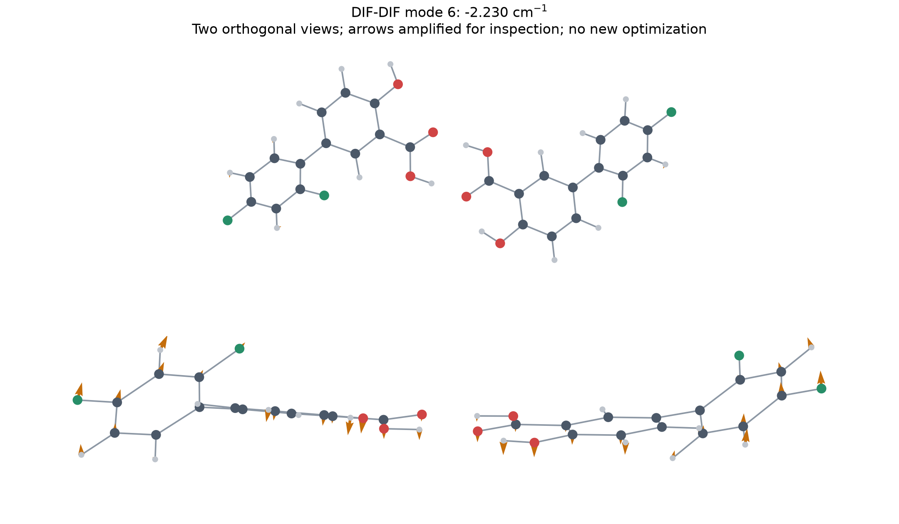

# 3주차 DIF–DIF 검토와 한 차례 재계산

2026-09-11. 사용자 지시: “다음단계 진행하자”. [현재 전체 상태](../WEEK3_RESULTS.ko.md).

## 확인한 문제

원래 DIF–DIF p05는 정상 종료와 구조 최적화 수렴을 확인했지만, 내부 진동 150개 중 하나가 −2.2295005203 cm⁻¹였다. 최소점 검증은 실패로 보존한다. 화학 결합 그래프와 수소의 소속은 유지됐고 분자가 떨어져 나가지 않았다.

Hessian 좌표가 최종 구조와 같은지 원자 대응 및 회전·이동 정렬로 검증했다. 6번 모드는 전체 구조의 병진·회전이 투영되어 제거된 내부 모드다. 두 분자 각각에 질량 가중 최소제곱으로 강체 이동·회전을 맞추면 모드의 질량 가중 제곱 진폭 중 97.84397%를 설명한다. 두 분자의 상대적인 흔들림이 주된 움직임이라는 해석이며, 수치 오차일 확률을 뜻하지 않는다. 실제 음의 곡률인지 수치·수렴 문제인지는 재계산 전에는 미확정이다.

그림의 화살표는 이해를 위해 임의로 확대했다. [세 프레임 XYZ](mode6-visualization.xyz)는 새 최적화나 열적 진폭 예측이 아니다. 실제 재계산 입력은 변위시키지 않은 원래 최종 XYZ다. [정량 검토](mode-inspection.json).

## 재계산과 다음 단계

- 계산 방법·기저·보정: 기존 r2SCAN-3c 유지, 진공·중성·단일항 유지.
- 수치 설정: TightSCF/TightOpt/기본 격자에서 VeryTightSCF/VeryTightOpt/DefGrid3로 강화.
- 계산 자원: 12 MPI, OpenMP 1, 최대 4시간, 프로세스 트리 RSS 40 GiB. 동시 연구 엔진 한 개.
- 원래 실패 시도와 재계산은 별도 실행 폴더·설정·보고서로 남긴다. 14개 초기 후보 중 동일 후보의 재계산이며 독립 시작점을 추가하지 않는다. 두 시도의 계산 시간을 모두 예산에 포함한다.
- 재계산은 정상 종료·SCF·기하 수렴·화학 그래프·Hessian 좌표 일치와 **모든 내부 진동 > 0**를 확인해야 통과한다. 또 실패하면 다시 자동 재시도하지 않는다.
- 통과한 최종 좌표에서 기존 TightSCF/기본 격자 EnGrad 단일점을 한 번 계산한다. 이 에너지를 기존 후보들과의 비교에 사용한다. 최대 15분이며 별도 최소점으로 세지 않는다.
- 강화 설정과 기본 설정의 동일 좌표 에너지 차이 ≤0.1 kcal/mol, 최대 기울기 성분 차이 ≤1e-4 Eh/bohr를 확인한다. 이는 이 구조의 수치 민감도만 점검하며 다른 후보 전체나 방법 오차의 상한은 아니다. 이 기준을 넘으면 비교표 확정을 보류한다.
- 두 검증을 통과하면 남은 약물 초기 후보 8개를 원래 순서로 실행하고, 그 뒤 MoS2/MoSe2 기준 계산으로 넘어간다. 4주차 작업은 포함하지 않는다.

## 확인 근거

기록된 원시 실패 결과를 덮어쓰지 않고 모드 확인 후 더 엄격한 설정으로 한 차례 재최적화한다는 [원래 프로토콜](../../docs/EXPERIMENT_PROTOCOL_V1.ko.md)의 기준을 따른다.

[ORCA 최적화 설명](https://www.faccts.de/docs/orca/6.1/tutorials/prop/geoopt.html)은 약한 분자 간 상호작용에서 잔류 허수진동이 생길 수 있으며 수렴 조건 강화 또는 모드 방향 검토가 필요하다고 설명한다. [수렴 허용치](https://www.faccts.de/docs/orca/6.1/manual/contents/structurereactivity/optimizations.html)와 [적분 격자 설명](https://www.faccts.de/docs/orca/6.1/manual/contents/essentialelements/numericalintegration.html)을 확인해 설정을 정했다.

실제 보관된 Hessian·기울기 파일 검증, 좌표 변형 및 메타데이터 변조 거부, 합성 메타데이터를 사용한 수치 기준 통과/실패 검사를 포함해 총 28개 테스트가 통과했다. 이는 재계산 엔진의 완료 또는 최소점 검증 성공을 대신하지 않는다. [테스트 로그](verification-tests.log).

[원래 실행과 보고서 사본](before-resume/WEEK3_RESULTS.ko.md), [고정된 재계산 계획](../../experiments/week3/drug/recovery-plan-r1.json).
